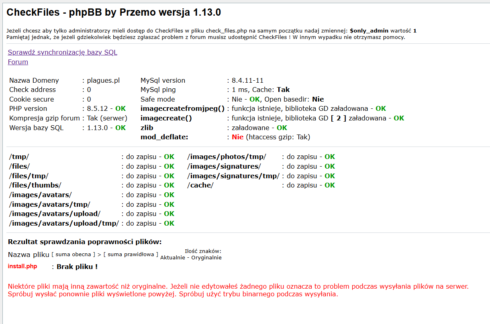

# phpBB modified by Przemo

Polska modyfikacja forum **phpBB 2**, znana jako *phpBB by Przemo*. Projekt rozszerzał phpBB 2 o rozbudowany zestaw funkcji administracyjnych i użytkowych. Ta kopia repozytorium zawiera wersję **1.13.0**.

Projekt 1.13.0 wspiera **Plague Studio** ([plagues.pl](https://plagues.pl)).

> Demo projektu działa na PHP 8.5; właściciel potwierdza, że wszystkie funkcje działają bez błędów. Przed wdrożeniem przeczytaj [audyt bezpieczeństwa](SECURITY_AND_COMPATIBILITY_AUDIT.md) i sprawdź zgodność konkretnej konfiguracji bazy danych.

## Co zawiera

- klasyczny silnik phpBB 2 z modyfikacjami Przema;
- rozbudowany Panel Administracyjny i funkcje, które można konfigurować;
- instalator w `install.php`;
- narzędzia aktualizacji bazy w `scripts/`;
- dodatkową dokumentację i materiały projektu w [`docs/`](docs/).

## Wymagania 1.13.0

- **PHP 8.5.x** oraz włączone rozszerzenie **`mysqli`** — instalator 1.13.0 sprawdza i używa MySQLi.
- **Serwer MySQL lub kompatybilny MariaDB** dostępny przez MySQLi. Zalecana jest aktualnie wspierana linia LTS; obecnie jest to MySQL 9.7 LTS ([oficjalne wydania](https://dev.mysql.com/doc/relnotes/mysql/9.7/en/)). Dokładne minimum serwera bazy nie jest egzekwowane przez instalator, a wersja bazy używana przez demo nie jest tu deklarowana.
- Aktualne wydanie PHP 8.5 to **8.5.12** ([oficjalne wydania PHP](https://www.php.net/downloads.php), stan na 27 października 2026).

## Zrzut z demo

Kontrola Systemu na demo Plague Studio: PHP 8.5.12, MySQL 8.4.11-11 oraz wersja bazy 1.13.0.

## Instalacja

1. Przygotuj serwer WWW z PHP 8.5.x i rozszerzeniem `mysqli`, a także dostępną bazą MySQL lub kompatybilną MariaDB.
2. Utwórz bazę danych i konto z uprawnieniami do tworzenia oraz modyfikowania tabel.
3. Wgraj pliki forum do katalogu docelowego.
4. Otwórz `https://twoja-domena.example/forum/install.php` (dostosuj adres i ścieżkę) i wypełnij formularz. Podaj host, nazwę bazy, użytkownika, hasło, prefiks tabel oraz dane administratora.
5. Jeśli instalator nie może zapisać `config.php`, pobierz wygenerowany plik i umieść go ręcznie w katalogu głównym forum.
6. Po zakończeniu instalacji usuń lub zablokuj dostęp do instalatora i sprawdź uprawnienia plików oraz katalogów.

Szczegółową procedurę opisuje [Wiki: Instalacja](https://github.com/Sh4d0v/phpbb_by_przemo/wiki/Instalacja).

## Najnowsze poprawki 1.13.0

W wydaniu 1.13.0 wprowadzono wiele poprawek i naprawiono wiele błędów, m.in. w Panelu Administracyjnym, instalatorze, obsłudze PHP 8.5, imporcie stylów, ochronie formularzy i aktualizacji bazy. Pełna [historia wszystkich commitów](https://github.com/Sh4d0v/phpbb_by_przemo/commits/main/) zawiera szczegółową listę zmian. Zobacz także [Patch 1.13.0 w Wiki](https://github.com/Sh4d0v/phpbb_by_przemo/wiki/Patch-1.13.0) oraz [raport audytu](SECURITY_AND_COMPATIBILITY_AUDIT.md), który opisuje również pozostałe ryzyka.

## Aktualizacja i migracja

Przed każdą operacją wykonaj kopię plików i bazy danych. Aktualizator `scripts/update.php` przygotowuje bazę Przema 1.12.9 do wydania 1.13.0; następnie wgraj pliki 1.13.0 i zachowaj istniejący `config.php`. Szczegóły oraz ważne uwagi o zachowaniu danych są w [Wiki: Aktualizacja i migracja](https://github.com/Sh4d0v/phpbb_by_przemo/wiki/Aktualizacja-i-migracja).

## Dokumentacja

- [Wiki projektu](https://github.com/Sh4d0v/phpbb_by_przemo/wiki)
- [Audyt bezpieczeństwa i zgodności](SECURITY_AND_COMPATIBILITY_AUDIT.md)
- [Autorzy](docs/AUTHORS)
- [Licencja GNU GPL v2](docs/COPYING)

## Licencja i autorstwo

Plik [`docs/COPYING`](docs/COPYING) zawiera GNU General Public License w wersji 2. [`docs/AUTHORS`](docs/AUTHORS) wskazuje autorstwo modyfikacji Przema i odsyła do oryginalnej listy autorów phpBB. Zachowaj istniejące informacje o prawach autorskich i licencji przy dalszym rozpowszechnianiu.

To repozytorium jest archiwum kodu; nie należy z niego wyciągać wniosków o bieżącym wsparciu, poprawkach bezpieczeństwa ani oficjalnym statusie projektu.

